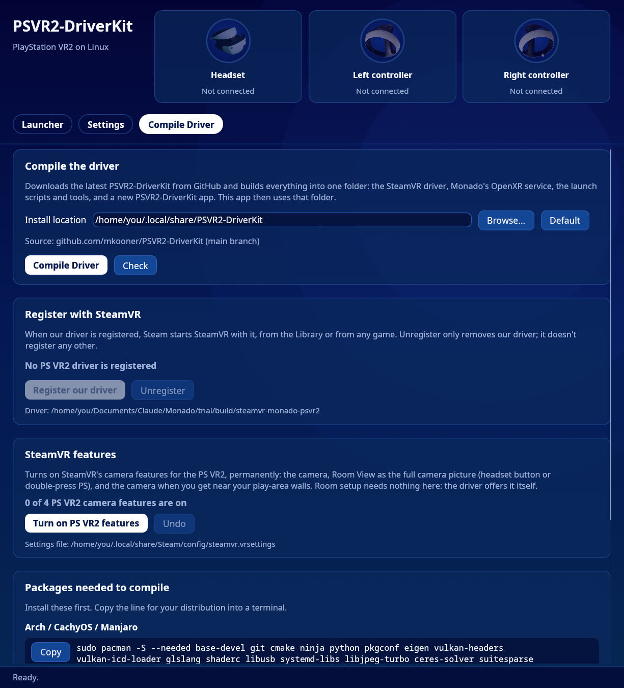

# PSVR2-DriverKit – PlayStation VR2 Linux Driver

**PSVR2-DriverKit is an open-source Linux driver and management toolkit for the Sony PlayStation VR2 headset and
Sense controllers, based on [Monado](https://monado.freedesktop.org/).** It extends Monado's PS VR2 headset and
Sense controller drivers, and adds a native SteamVR driver built on them. It runs SteamVR games and native OpenXR
apps, with 6DoF headset and controller tracking, eye tracking, Room View passthrough and haptics. The PSVR2-DriverKit
app installs, compiles, registers and launches everything.

Everything runs as native Linux code: no Windows, Wine or Sony Windows driver underneath. The same Monado-based PS VR2
and Sense drivers serve both SteamVR games and native OpenXR apps.

**[Download the latest release](https://github.com/mkooner/PSVR2-DriverKit/releases/latest)** ·
[Installation guide](docs/psvr2-installation.md) · [Compatibility](docs/compatibility.md) ·
[Troubleshooting](docs/troubleshooting.md) · [Report a problem](https://github.com/mkooner/PSVR2-DriverKit/issues/new/choose)



## Features

| Feature | Status |
|---|---|
| Native SteamVR driver, registered with Steam, runs in Steam's runtime container | Stable |
| OpenXR apps on Monado (`monado-service`) without SteamVR | Stable |
| Headset 6DoF tracking (the headset's inside-out tracking + our pose filter) | Stable |
| Lens distortion correction, IPD from the headset's dial, wear sensor | Stable |
| Sense controllers: 6DoF (camera LED tracking + motion sensors) | Stable (drops in bright sunlight) |
| Sense controllers: all buttons, sticks, triggers, capacitive touch, finger-distance sensors | Stable |
| Haptics | Stable |
| Hand skeleton from the controllers' touch and distance sensors | Stable |
| Room View passthrough and the camera near play-area walls (SteamVR) | Stable (not on Intel Arc) |
| Room setup in the headset (SteamVR Playspace menu) | Stable |
| Eye tracking (SteamVR and OpenXR `XR_EXT_eye_gaze_interaction`) | Works, no per-user calibration yet |
| Bare-hand tracking (Monado's Mercury tracker) | Experimental, off by default |
| Your desktop in VR through [WayVR](https://github.com/wayvr-org/wayvr) | Experimental, off by default |
| PSVR2-DriverKit app: install, compile, register, launch, settings, device status | Stable |

### Headset
- **6DoF head tracking** from the headset's own inside-out tracking, smoothed by our pose filter.
- **Display:** distortion correction, IPD from the headset's dial.
- **Wear sensor:** SteamVR knows when the headset is on your head.
- **Function button** (under the visor): opens Room View, SteamVR's camera passthrough.
- **Passthrough cameras:** Room View in SteamVR, the full camera picture; the camera view near your play-area walls.
- **Eye tracking:** for OpenXR apps (`XR_EXT_eye_gaze_interaction`) and for SteamVR games (SteamVR's eye-tracking
  input). No per-user calibration yet. See [eye tracking](docs/psvr2-eye-tracking.md).

### Sense controllers
- **6DoF tracking:** the controllers' LEDs, tracked by the headset's cameras, fused with their motion sensors.
- **Every input:** all buttons, sticks, triggers and the grip; the touch sensors on the trigger, grip, stick and face
  buttons; the finger-distance sensors.
- **Haptics.**
- **Finger tracking:** a hand skeleton driven by the Sense's touch and distance sensors, for games that animate hands.
- **PS button:** opens the SteamVR dashboard. See [Sense controllers](docs/psvr2-sense-controllers.md).

### Hand tracking (experimental)
- **Bare-hand tracking** with the headset's cameras, using Monado's Mercury hand tracker, while a Sense controller
  is off. Off by default: turn it on in DriverKit's Settings tab.
- **Finger tracking** in SteamVR games, a pinch as the trigger, a closed hand as the grip; palm toward your face and
  pinch for the dashboard.
- Needs a driver compiled with Compile hand tracking ticked (DriverKit's Compile Driver tab).

### SteamVR integration
- **A native SteamVR driver.** Registered with Steam, so Steam starts SteamVR with it like any headset, from the
  Library or from a game.
- **Runs inside Steam's runtime container.** The libraries Steam's runtime lacks are bundled with the driver.
- **PS VR2 input profiles and bindings:** Sense controller bindings for SteamVR and for older games.
- **Room setup in the headset:** draw your play area from the dashboard's Playspace menu, like Steam Frame.
- **Room View and the wall camera,** switched on with one button in DriverKit.
- **The PS VR2 and Sense controller models and icons** in SteamVR, when Sony's PlayStation VR2 App is installed (see
  the install guide).

### Desktop in VR (with WayVR, experimental)
- **Your Linux desktop inside SteamVR,** on Wayland and X11, through
  [WayVR](https://github.com/wayvr-org/wayvr), a separate overlay program you install yourself (Arch: the AUR package
  `wayvr`; other distributions: its AppImage in `~/Applications`). It isn't part of this repository.
- **Sense controller bindings for WayVR come with the driver:** double-press Triangle shows or hides its overlays,
  L2/R2 click (touch shows the pointer), L1/R1 grab (move; grab + trigger + stick resizes), the sticks scroll, and
  touching Triangle/Circle or Square/Cross while clicking gives a right or middle click.
- **Started with SteamVR:** turn on Start WayVR with SteamVR in DriverKit's Settings tab. DriverKit then starts WayVR
  before SteamVR (as WayVR asks), restarts it if it stops unexpectedly, and stops it after SteamVR. The first time,
  your desktop asks which screens to share: pick them in the order WayVR asks.

### OpenXR with Monado
- **Native OpenXR apps run directly on Monado's runtime** (monado-service), without SteamVR. See
  [OpenXR on Linux](docs/psvr2-openxr-linux.md).

### PSVR2-DriverKit app
- **Compile Driver tab:** installs the build packages, downloads this repository and builds everything into one
  folder. It can also register the driver with SteamVR, turn on SteamVR's camera features, and allow SteamVR's
  high-priority GPU queue.
- **Launcher tab:** start and stop SteamVR with the driver; set the play area; start monado-service and launch
  OpenXR apps.
- **Settings tab:** driver options.
- **Device status:** headset and controllers.

## Supported hardware

- **PlayStation VR2 headset** with **Sony's PS VR2 PC adapter** (DisplayPort + USB).
- **PS VR2 Sense controllers** over Bluetooth.
- A Linux PC with a free DisplayPort output. GPUs: NVIDIA tested; Intel Arc runs with limits; AMD expected but not
  yet reported. See the [compatibility matrix](docs/compatibility.md).

## Compatibility

| | Status |
|---|---|
| SteamVR on Linux (native Steam, not Flatpak or Snap) | Supported |
| Monado / OpenXR | Supported (this repository's fork) |
| GNOME Wayland | Tested |
| KDE Plasma / Sway / Hyprland Wayland, X11 | Expected (DRM leasing); untested by us |
| Arch-, Debian-, Fedora-based distributions | Automatic package install; tested on CachyOS |
| NVIDIA | Tested |
| Intel Arc | Runs; no async reprojection; Room View can crash SteamVR (set Headset cameras to `off`) |
| AMD | Expected; untested by us |
| Windows | Not supported |

Full details: [docs/compatibility.md](docs/compatibility.md).

## Installation

Full guide: [docs/psvr2-installation.md](docs/psvr2-installation.md).

### What you need
- **A Linux PC with Steam and SteamVR installed.** Run SteamVR once so it creates its settings.
- **The PS VR2 connected through Sony's PC adapter.**
- **Recommended: Sony's PlayStation VR2 App from Steam** (free). The driver uses its Sense controller models and PS VR2
  icons, so SteamVR shows the real controllers instead of generic ones. Sony's files aren't in this repository: the
  compile step copies them from your Steam library, so **install the app before compiling** (or compile again after
  installing it). Without it everything works, but SteamVR shows other controllers and generic icons.

### Quick start with the AppImage
1. Download `PSVR2-DriverKit-x86_64-<version>.AppImage` from the
   [latest release](https://github.com/mkooner/PSVR2-DriverKit/releases/latest), then
   `chmod +x PSVR2-DriverKit-*.AppImage` and run it.
2. Continue at step 3 below.

### Steps (from source)
1. **Get the repository and install the build packages:**
   ```
   git clone https://github.com/mkooner/PSVR2-DriverKit.git
   cd PSVR2-DriverKit && ./install-deps.sh
   ```
   `install-deps.sh` finds your package manager (Arch based: pacman, Debian based: apt, Fedora based: dnf) and asks for
   your password. Add `--hand-tracking` for the experimental hand tracking's packages too. It also installs our copy
   of Monado's [xr-hardware](https://gitlab.freedesktop.org/monado/utilities/xr-hardware) udev rules
   (`udev/70-xrhardware.rules`) as `/etc/udev/rules.d/70-xrhardware.rules` and reloads udev: without them only root
   can open the headset and the Sense controllers, and the controllers aren't found.
2. **Build the DriverKit app once from source:**
   ```
   cd launcher-gui && cargo build --release
   ./target/release/PSVR2-DriverKit
   ```
3. **Compile Driver tab → Compile Driver.** (With the AppImage, press **Install dependencies** first.)
   - **Hand tracking (experimental):** tick Compile hand tracking, press Install dependencies (it adds OpenCV and
     onnxruntime), then Compile Driver. Needs Debian 13, Ubuntu 25.04, Fedora 43 or newer, or an Arch
     based system; the driver gets several hundred MB bigger.
   - **Where it installs:** by default `~/.local/share/PSVR2-DriverKit`. Choose another folder with Browse.
   - **What it builds:** it downloads the latest version of this repository and builds the SteamVR driver,
     monado-service, the launch scripts and tools, and a new copy of DriverKit, all into that folder. A progress bar
     shows the build.
   - **What happens after:** everything uses the new build, and the new DriverKit is in `<install folder>/kit`. Use
     that one from now on; compiling again later updates it.
4. **Register our driver** (same tab). From now on Steam starts SteamVR with the PS VR2 driver. Unregister removes only
   our driver.
5. **Turn on PS VR2 features** (same tab), once, with SteamVR closed. This switches on SteamVR's camera features for the
   PS VR2: Room View with the full camera picture, and the camera near your play-area walls. Undo puts your previous
   settings back.
6. **Start SteamVR from Steam** (or start a VR game). On the first start, set up your room from the dashboard's
   Playspace menu.

## Configuration

DriverKit's **Settings** tab holds the driver options: render size, refresh rate (89.91 or 119.88 Hz), legacy games'
controller layout, the headset cameras (`on` / `noimages` / `off`), a lighter camera picture, hand tracking, Start
WayVR with SteamVR and more. The SteamVR driver reads them each time SteamVR starts, however SteamVR is started. See
the [SteamVR page](docs/psvr2-steamvr-linux.md#settings-worth-knowing).

## SteamVR setup

- **SteamVR games:** start them from Steam as usual.
- **PS button:** opens the SteamVR dashboard.
- **Headset's function button:** Room View.
- **Windows games through Proton:** start SteamVR first; [UMU-Proton](https://github.com/Open-Wine-Components/umu-proton)
  works best for VR.
- **Async reprojection:** DriverKit → Compile Driver → SteamVR features → **Allow high priority** (your choice; not
  done by default).

Details: [docs/psvr2-steamvr-linux.md](docs/psvr2-steamvr-linux.md).

## OpenXR / Monado setup

DriverKit → Launcher → **Start monado-service**, then **Launch app**, or `kit/launch-openxr.sh /path/to/app`.
Details: [docs/psvr2-openxr-linux.md](docs/psvr2-openxr-linux.md).

## Wayland and X11

SteamVR and Monado lease the headset's display from your desktop, so a Wayland compositor needs DRM leasing. It's
tested on GNOME Wayland. SteamVR's own dashboard Desktop panel is blank on Wayland
([SteamVR bug](https://github.com/ValveSoftware/SteamVR-for-Linux/issues/693)); use WayVR instead (above). Details:
[docs/psvr2-wayland.md](docs/psvr2-wayland.md).

## Controller support

PS VR2 Sense controllers with 6DoF tracking, every input, haptics and a hand skeleton. Games without SteamVR Input
see Oculus Touch controllers by default (or Vive, Index or native, in Settings). Pairing and details:
[docs/psvr2-sense-controllers.md](docs/psvr2-sense-controllers.md).

## Troubleshooting

[docs/troubleshooting.md](docs/troubleshooting.md) covers:
- controllers not found (udev rules, pairing);
- another program holding the headset;
- flicker without async reprojection;
- the Intel Arc Room View crash;
- compile failures;
- games opening on the desktop.

Start SteamVR from DriverKit's Launcher to get the pre-flight checks and a log summary; attach the zipped
`kit/logs` folder to issues.

## Known limitations

- Controller tracking drops in bright sunlight.
- The controllers' initial calibration takes about 5 seconds to start in SteamVR.
- No async reprojection on Intel Arc GPUs; Room View can crash SteamVR's compositor on Intel Arc.
- No passthrough on Monado / OpenXR.
- Eye tracking has no per-user calibration yet.
- SteamVR's own Desktop panel in the dashboard stays blank on Wayland
  ([a SteamVR bug](https://github.com/ValveSoftware/SteamVR-for-Linux/issues/693)); use WayVR (Desktop in VR above).
- For the best results with Proton in VR, use [UMU-Proton](https://github.com/Open-Wine-Components/umu-proton).

## Roadmap

Planned, not available yet:
- per-user eye-tracking calibration;
- a built-in hidden-area mask (less GPU work per frame);
- steadier room anchoring;
- more robust bare-hand tracking.

Windows support isn't planned until the Linux version is stable.

## Contributing

Contributions, test reports and hardware reports are welcome: see [CONTRIBUTING.md](CONTRIBUTING.md). Please follow the
[code of conduct](CODE_OF_CONDUCT.md); report security problems as described in [SECURITY.md](SECURITY.md).
- **Bugs and installation problems:** [issue templates](https://github.com/mkooner/PSVR2-DriverKit/issues/new/choose).
- **Hardware compatibility reports** (GPU, desktop, distribution): same link.
- **Feature requests:** same link.

## FAQ

Common questions (do I need Windows? does eye tracking work? which GPUs?) are answered in [docs/faq.md](docs/faq.md).
How this project relates to other PS VR2 Linux projects: [docs/PROJECT_COMPARISON.md](docs/PROJECT_COMPARISON.md).

## Credits
- **[Monado](https://monado.freedesktop.org/)** (all the Monado developers, BSL-1.0): the OpenXR runtime this project
  is built on and part of, including the PS VR2 headset and Sense controller drivers this project extends.
- **[ALVR](https://github.com/alvr-org/ALVR)** (MIT): our reference implementation for the SteamVR driver's structure
  (provider, tracked devices, headset and controllers) and for the controller hand skeleton.
- **[WayVR](https://github.com/wayvr-org/wayvr)** (GPL-3.0, a separate program, not included): the desktop overlay we
  start and ship controller bindings for.
- **Mercury** (Moshi Turner and Collabora, part of Monado, BSL-1.0): the hand tracker and models behind hand tracking.
- **[PSVR2Toolkit](https://github.com/BnuuySolutions/PSVR2Toolkit)** (Bnuuy Solutions, MIT): our reference
  implementation for:
  - the SteamVR camera interfaces behind Room View, and the passthrough cameras' lens model;
  - the PS VR2 properties SteamVR expects;
  - reporting eye tracking to SteamVR.
- **Device pictures in PSVR2-DriverKit:** from Wikimedia Commons: the headset by C.Suthorn
  ([CC BY-SA 4.0](https://commons.wikimedia.org/wiki/File:PSVR2_(Non-Stereoscopic).png)), the controllers by
  ArlindoPereira ([CC BY 4.0](https://commons.wikimedia.org/wiki/File:PlayStation_VR2.jpg)).

PlayStation, PS VR2 and Sense are trademarks of Sony Interactive Entertainment; SteamVR is a trademark of Valve.
This project is independent and not affiliated with or endorsed by either.

## Repository layout

| Path | What |
|---|---|
| `monado/` | The Monado fork (BSL-1.0): PS VR2 headset driver (`src/xrt/drivers/psvr2`), Sense controllers (`src/xrt/drivers/pssense`), the SteamVR driver (`src/xrt/state_trackers/steamvr_psvr2`, built as `steamvr-monado-psvr2`). |
| `launcher-gui/` | PSVR2-DriverKit (Rust, eframe). |
| `build-driver.sh` | What Compile Driver runs: clone/update, build, bundle the libraries for Steam's runtime, copy Sony's models and icons, install. |
| `launch-steamvr.sh`, `launch-openxr.sh`, `launch-dev.sh` | Run SteamVR or an OpenXR app with the driver, with logging; `launch-dev.sh` uses a development build without registering it. |
| `analysis/`, `tools/`, `ctreplay/`, `pose-sim/`, `vio/` | Measurement, replay and test tools used during development. |
| `docs/` | User documentation, research notes and the README's images. |
| `site/` | The project website (static, built by `site/build.py`, deployed to GitHub Pages). |

## Building by hand (developers)

    cmake -S monado -B monado/build -G Ninja -DCMAKE_BUILD_TYPE=RelWithDebInfo
    ninja -C monado/build                        # monado-service, the SteamVR driver, tests
    (cd launcher-gui && cargo build --release)   # launcher-gui/target/release/PSVR2-DriverKit

The scripts find the build through `~/.config/PSVR2-DriverKit/driver.env`, which Compile Driver writes; for a build
of your own, point them at it with `MONADO_BUILD=$PWD/monado/build`. Logs go to `logs/`.

## License

[Boost Software License 1.0](LICENSE), like Monado. Third-party components keep their own licenses (see Credits).
