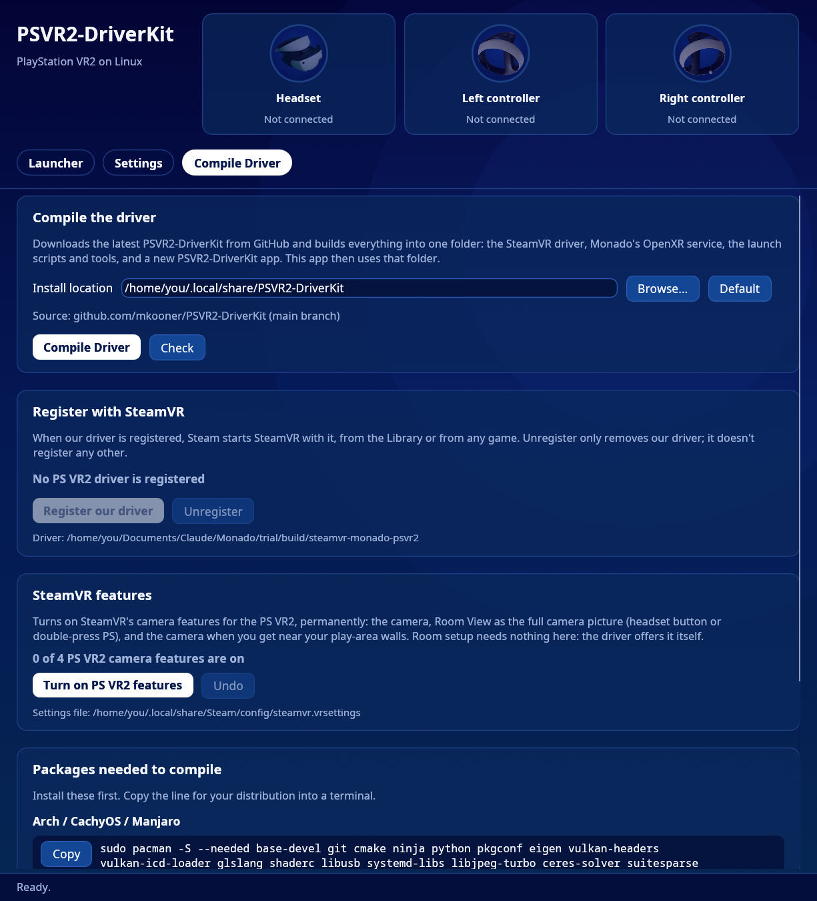

# How to install the PSVR2 driver on Linux

This guide installs PSVR2-DriverKit: the PS VR2 SteamVR driver, Monado's OpenXR runtime with the PS VR2 drivers, and
the PSVR2-DriverKit app that manages them.

Repository: <https://github.com/mkooner/PSVR2-DriverKit> · Releases:
<https://github.com/mkooner/PSVR2-DriverKit/releases>



## Before you start

- **Steam (the native package) and SteamVR.** Run SteamVR once so it creates its settings. The Flatpak and Snap
  versions of Steam break the headset's display lease and reprojection, so they're not supported.
- **The PS VR2 on Sony's PC adapter**, plugged into a DisplayPort output of your GPU and a USB port.
- **Recommended: Sony's PlayStation VR2 App from Steam** (free). The compile step copies its Sense controller models
  and PS VR2 icons from your Steam library, so SteamVR shows the real controllers. Install it **before** compiling,
  or compile again afterwards. Without it everything works, but SteamVR shows generic controllers.
- **Pair the Sense controllers** in your Bluetooth settings once: hold **Create + PS** until the light flashes.

## Option A: the AppImage (easiest)

1. Download `PSVR2-DriverKit-x86_64-<version>.AppImage` from the
   [latest release](https://github.com/mkooner/PSVR2-DriverKit/releases/latest).
2. Make it executable and run it:
   ```
   chmod +x PSVR2-DriverKit-x86_64-*.AppImage
   ./PSVR2-DriverKit-x86_64-*.AppImage
   ```
3. Continue with [the Compile Driver tab](#the-compile-driver-tab).

## Option B: from source

```
git clone https://github.com/mkooner/PSVR2-DriverKit.git
cd PSVR2-DriverKit && ./install-deps.sh
cd launcher-gui && cargo build --release
./target/release/PSVR2-DriverKit
```

`install-deps.sh` finds your package manager (pacman, apt or dnf) and asks for your password. Add `--hand-tracking`
to also install OpenCV and onnxruntime for the experimental hand tracking. `--list` shows what it would do without
installing anything.

## The Compile Driver tab

1. **Install dependencies.** This runs `install-deps.sh` through a password prompt. It also installs the udev rules
   (`/etc/udev/rules.d/70-xrhardware.rules`, from Monado's xr-hardware). Without them only root can open the
   headset and the controllers, and the controllers aren't found.
2. **Compile Driver.** This downloads the latest version of this repository and builds the SteamVR driver,
   monado-service, the launch scripts and a new copy of DriverKit into one folder (default
   `~/.local/share/PSVR2-DriverKit`). After that, use the new DriverKit in `<install folder>/kit`. The AppImage
   switches to it by itself, and compiling again later updates everything.
   - **Compile hand tracking (experimental):** tick it before Install dependencies and Compile Driver. Needs Debian 13,
     Ubuntu 25.04, Fedora 43 or newer, or an Arch-based system. The driver gets several hundred MB bigger.
3. **Register our driver.** From now on Steam starts SteamVR with the PS VR2 driver. Unregister removes only ours.
4. **Turn on PS VR2 features**, once, with SteamVR closed. This switches on SteamVR's camera features: Room View with
   the full camera picture, and the camera view near your play-area walls. Undo restores your previous settings.
5. **Optional: Allow high priority** (SteamVR features section). This gives SteamVR's compositor the Linux
   capability it needs for a high-priority GPU queue, which async reprojection requires. You choose it yourself; it
   isn't done by default.

## First start

Start SteamVR from Steam, or start a VR game. On the first start, set up your room from the SteamVR dashboard's
**Playspace** menu. Then hold both Sense controllers in front of the headset for a few seconds while their tracking
starts.

## Updating

Run **Compile Driver** again. It updates the repository copy and rebuilds everything in place.

## Uninstalling

DriverKit → Compile Driver tab → **Unregister**, then delete the install folder (default
`~/.local/share/PSVR2-DriverKit`) and `~/.config/PSVR2-DriverKit`. If you no longer want the udev rules, remove
`/etc/udev/rules.d/70-xrhardware.rules`.

## Next

[SteamVR setup](psvr2-steamvr-linux.md) · [OpenXR without SteamVR](psvr2-openxr-linux.md) ·
[Troubleshooting](troubleshooting.md) · [Compatibility](compatibility.md)
